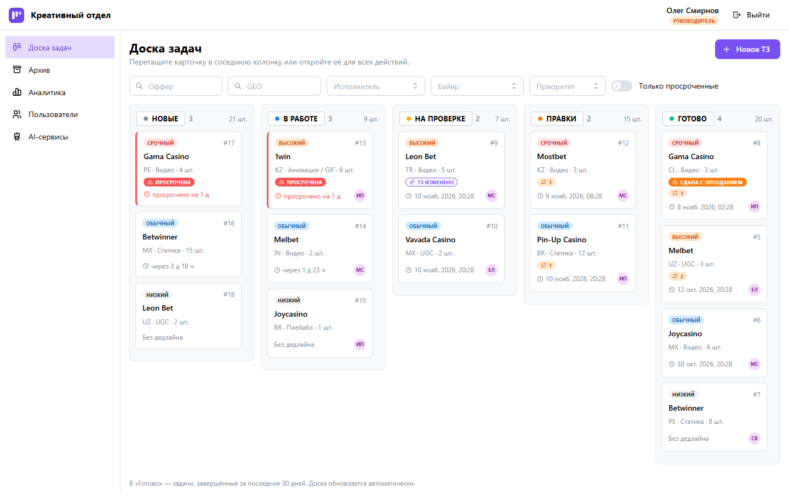
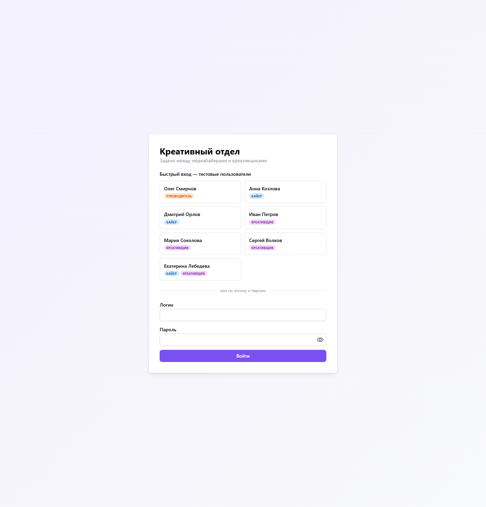
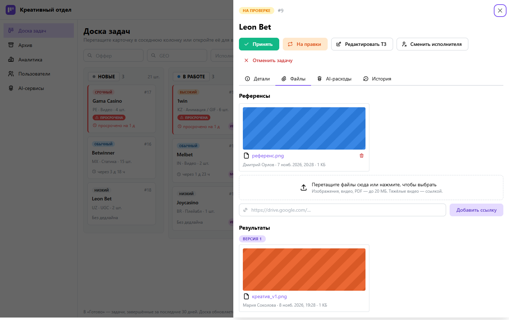
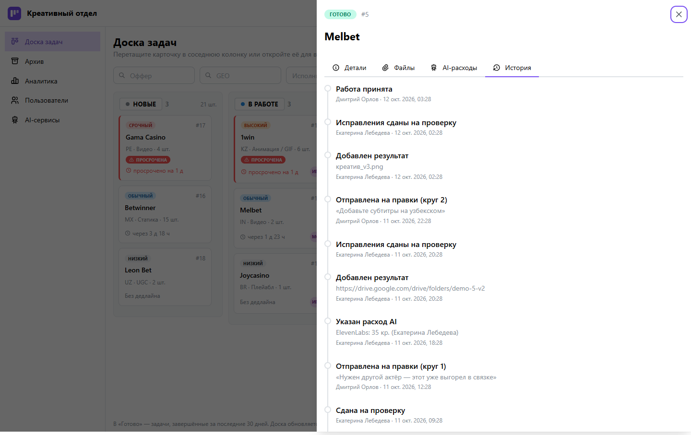
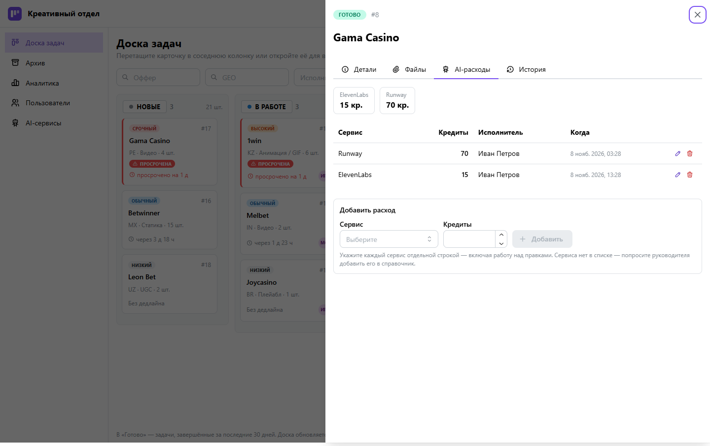
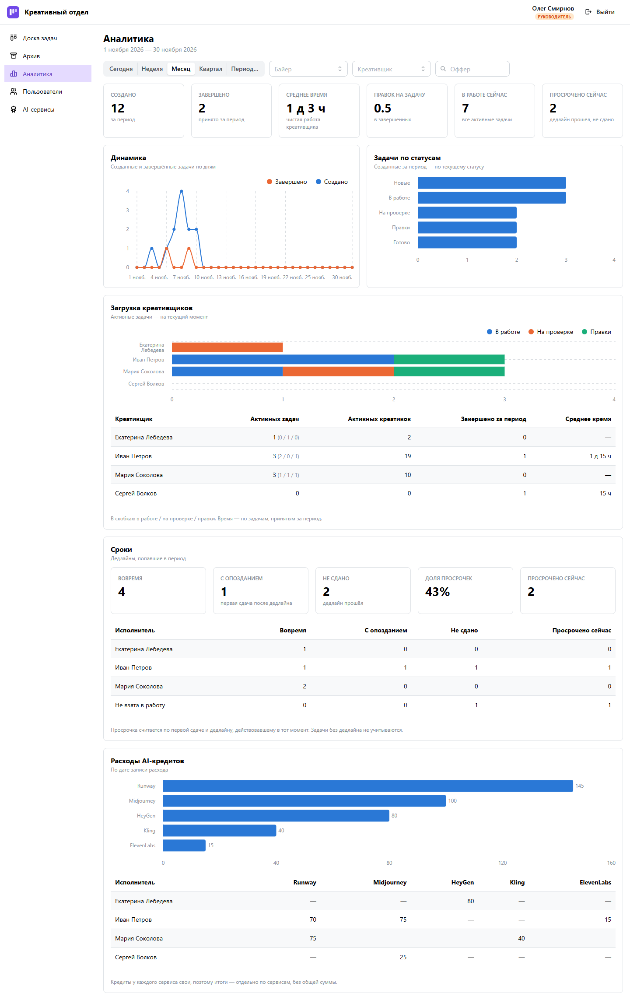
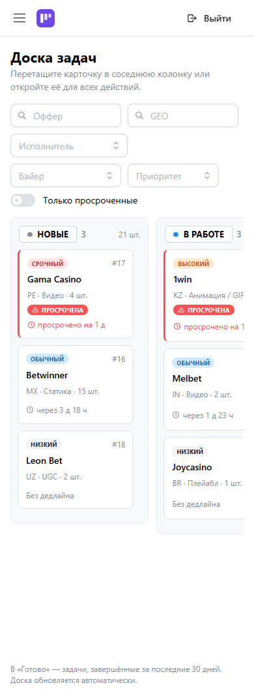

# Креативный отдел — тестовое задание для Aff Saints

Веб-сервис для постановки, отслеживания и контроля задач между медиабайерами и креативщиками: ТЗ через форму, канбан-доска, автоматический учёт времени, учёт AI-кредитов и аналитика для руководителя.

**Демо:** _ссылка появится после развёртывания_ · вход — кнопками тестовых пользователей на экране входа.



## Что умеет

| Требование ТЗ | Как реализовано |
|---|---|
| Роли: байер, креативщик, руководитель | Несколько ролей у одного пользователя; права проверяются на backend, а UI получает от backend список доступных действий по каждой задаче |
| Постановка ТЗ через форму | Оффер, GEO, тип, количество, описание, референсы (ссылки и файлы), приоритет, дедлайн с быстрыми кнопками «+1 день / +3 дня / +1 неделя». Без дедлайна — диалог с последствиями |
| Kanban: Новые → В работе → На проверке → Правки → Готово | Перетаскивание только по разрешённым переходам, фильтры, сортировка «приоритет → дедлайн», подсветка просрочек, автообновление раз в 12 с |
| Креативщик берёт сам, прикладывает результат, байер принимает или отправляет на правки | Общий пул; защита от гонки «двое нажали Взять» (`SELECT … FOR UPDATE`); сдать можно только с результатом текущей версии; результаты хранятся по версиям правок |
| Учёт времени | Фиксируются создание, взятие, первая и последняя сдача, завершение. Считается **чистое время работы креативщика** — без ожидания проверки, с учётом правок и смены исполнителя |
| Учёт AI-расходов | Справочник сервисов, кредиты по задаче (включая правки) с итогами по каждому сервису |
| Аналитика руководителя | Количество задач, загрузка сотрудников, среднее время, просрочки (по первой сдаче), AI-кредиты по сервисам и исполнителям; период и фильтры |
| История действий и статусов | Каждое действие и изменение каждого поля ТЗ — в журнале задачи |
| Демоверсия с тестовыми данными | 7 пользователей, 20 задач во всех статусах с историей; ночной сброс |

Неоднозначные места ТЗ (22 вопроса) разобраны до начала работы — см. [docs/decisions.md](docs/decisions.md).

## Тестовые пользователи

Пароль у всех: `demo12345` (или кнопки быстрого входа на экране входа).

| Логин | Имя | Роли |
|---|---|---|
| `head` | Олег Смирнов | Руководитель |
| `anna` | Анна Козлова | Байер |
| `dmitry` | Дмитрий Орлов | Байер |
| `ivan` | Иван Петров | Креативщик |
| `maria` | Мария Соколова | Креативщик |
| `sergey` | Сергей Волков | Креативщик |
| `kate` | Екатерина Лебедева | Байер + креативщик |

## Быстрый старт

Нужен только Docker:

```bash
cp .env.example .env
docker compose up --build
```

Откройте http://localhost:8180. При первом запуске применяются миграции и создаются демо-данные. Пересоздать демо-данные: `docker compose exec backend python -m app.cli seed --reset`.

Развёртывание на сервер с HTTPS — [deploy/README.md](deploy/README.md).

## Скриншоты

| | |
|---|---|
|  |  |
|  |  |





## Архитектура

```
browser ──► frontend (nginx: статика React + прокси /api) ──► backend (FastAPI) ──► PostgreSQL
                                                               └─► файлы (volume)
```

- **Backend:** Python 3.12, FastAPI, SQLAlchemy 2 (async) + Alembic, Pydantic 2. JWT в httpOnly-куке.
- **Frontend:** TypeScript, React 19, Vite, Mantine 9, TanStack Query, dnd-kit, графики Mantine Charts.
- **БД:** PostgreSQL 16. Все агрегаты аналитики считаются в SQL.
- **Инфраструктура:** Docker Compose; в проде — nginx + Let's Encrypt.

```
backend/   app/ (api, services, models, schemas, core), alembic/, tests/
frontend/  src/ (pages, components/tasks, api, hooks, lib), тесты рядом с кодом
e2e/       сквозные сценарии Playwright
deploy/    прод-конфигурация и инструкция
docs/      решения, журнал AI-инструментов, скриншоты
```

### Ключевые решения

- **Единый источник прав.** `app/services/task_permissions.py` и проверяет каждое действие, и отдаёт клиенту список доступных действий — кнопки и перетаскивание на фронте строятся только по нему.
- **Переходы статусов — одна транзакция** под блокировкой строки: статус + время + событие истории + отрезок работы.
- **Чистое время** считается по таблице отрезков работы; при смене исполнителя отрезок закрывается за прежним и открывается за новым.
- **Просрочка** — по первой сдаче и снимку дедлайна на тот момент: перенос дедлайна задним числом опоздание не стирает. В аналитике опоздание засчитывается тому, кто сдавал.
- **Файлы:** тип определяется по содержимому, SVG/HTML запрещены, отдача с `nosniff` и `CSP sandbox`.
- **Демо-данные** проигрываются через те же бизнес-сервисы с подменой часов — история и метрики в демо настоящие.

## Тесты и качество

| Уровень | Инструмент | Тестов |
|---|---|---|
| Backend | pytest на настоящем PostgreSQL (схема — через миграции) | 158 |
| Frontend | Vitest + Testing Library | 76 |
| Сквозные | Playwright | 2 сценария |

Линтеры и типы: ruff + mypy (strict), ESLint + Prettier + TypeScript strict. Всё запускается в GitHub Actions на каждый push; e2e — на одноразовом стенде Docker Compose.

```bash
# backend (нужна БД: docker compose up -d db)
cd backend && python -m venv .venv && .venv/Scripts/python -m pip install -e ".[dev]" && .venv/Scripts/python -m pytest
# frontend
cd frontend && npm ci && npm test
# e2e (нужен запущенный стенд)
cd e2e && npm ci && npx playwright install chromium && npx playwright test
```

## Использованные AI-инструменты

Проект сделан с **Claude Code** (CLI-агент Anthropic). Подробный журнал по этапам — [docs/ai-usage.md](docs/ai-usage.md).

**Как была организована работа**

1. **Разбор ТЗ до кода.** Агент выписал 22 неоднозначности с вариантом по умолчанию для каждой. Человек разобрал их по одной, из решений собран план из 11 этапов.
2. **Один и тот же цикл на каждом этапе:** реализация → рефакторинг → аудит (находки сначала записываются в документ, потом исправляются) → полный прогон тестов → коммит.
3. **Несколько агентов.**
   - *Основной агент* пишет код, тесты и документацию.
   - *Независимые агенты-аудиторы* (субагенты Claude Code) проверяли ключевые этапы: машину состояний и фронт доски. Аудитор получал только код и спецификацию, без рассуждений основного агента, чтобы не подтверждать чужие выводы. Он сам запускал тесты и `alembic check`, но код не правил.
   - *Параллельная работа:* пока аудитор проверял фронт доски, основной агент писал backend аналитики в других файлах.
   - Аудиторы нашли 10 значимых проблем, которые основной агент пропустил. Например:
     - перенос дедлайна после сдачи стирал опоздание;
     - при быстрых переносах карточек терялись ошибки;
     - просроченную задачу нельзя было отредактировать.
4. **Агент проверял свою работу глазами:** скриншоты headless Chrome (Playwright) после каждого фронтового этапа, перенос карточки реальной мышью, вёрстка на 390 px. По скриншотам исправлялись подписи, ширины и оси графиков.
5. **Скилл визуализации данных:** палитра графиков проверена его валидатором на различимость при дальтонизме.

**Что проверял человек:** все продуктовые решения (22 вопроса), план этапов, итоговый результат.

## Ограничения

- Сервис рассчитан на одну реплику backend: ограничитель попыток входа хранится в памяти процесса.
- Мягко удалённые файлы остаются на диске до ночного сброса демо.
- Обновление доски — опрос раз в 12 с (решение №19), без WebSocket.
